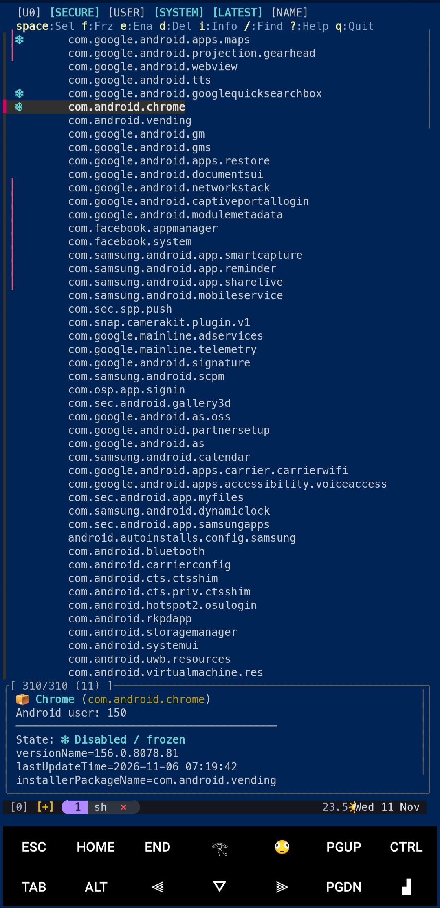
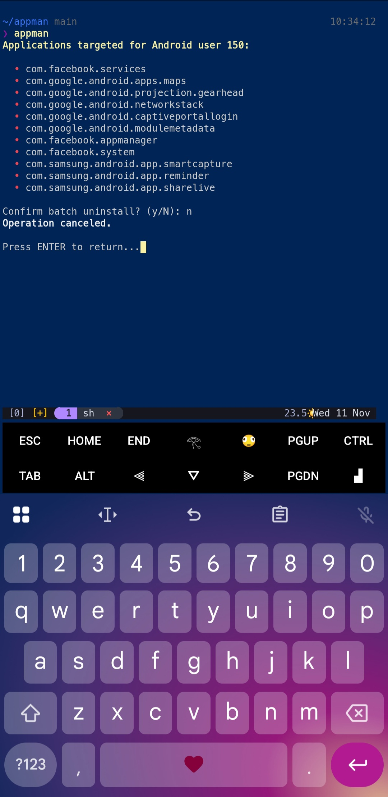
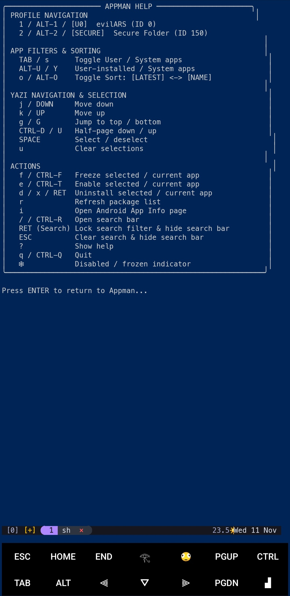

# yappman

A terminal-based Android app manager for rooted devices, built for Termux.

yappman gives you an interactive `fzf` interface to browse and manage installed Android applications across users and profiles.

Switch between profiles, filter user and system apps, search packages, inspect app details, and manage enabled or frozen states—all from your terminal.

## Screenshots

<p align="center">
  
  
  
</p>

## Installation

Clone the repository:

```bash
git clone https://github.com/royalewhite/yappman.git
cd yappman
```

Install the required `fzf` package:

```bash
pkg install fzf
```

Launch yappman:

```bash
./yappman
```

## Global Installation

To launch yappman from any directory, install all three executable files into Termux's binary directory:

```bash
install -m 755 yappman yappman-preview yappman-profiles "$PREFIX/bin/"
```

Now launch it with:

```bash
yappman
```

Keep the three files together because the main script uses the preview and profile helper scripts.

## Keyboard Controls

| Key | Action |
|:---|:---|
| `1–9` / `ALT-1–9` | Switch Android profiles |
| Header tabs | Switch profiles, filters, and sorting |
| `TAB` / `s` | Toggle User / System apps |
| `ALT-U` | Show User apps |
| `ALT-Y` | Show System apps |
| `o` / `ALT-O` | Toggle Latest / Name sorting |
| `j` / `↓` | Move down |
| `k` / `↑` | Move up |
| `g` / `G` | Jump to top / bottom |
| `CTRL-D` / `CTRL-U` | Half-page down / up |
| `SPACE` | Select / deselect an app |
| `u` | Clear selections |
| `f` / `CTRL-F` | Freeze selected apps |
| `e` / `CTRL-T` | Enable selected apps |
| `d` / `x` / `ENTER` | Uninstall selected or current app |
| `i` | Open Android App Info |
| `/` / `CTRL-R` | Open search |
| `ENTER` (in search) | Hide search and keep the filter |
| `ESC` | Clear search and close search mode |
| `r` | Refresh package list |
| `?` | Show help |
| `q` / `CTRL-Q` | Quit |


## Troubleshooting

### Profile discovery fails

Check that root access works and that your `sudo` command can execute Android package-manager commands.

### The interface does not start

Make sure `fzf` is installed and all three yappman scripts are present and executable.

### Application labels are missing in previews

Install or configure `aapt2` at `$PREFIX/bin/aapt2`.

Package names and other available metadata can still be displayed without it.

## Contributing

Contributions, suggestions, and bug reports are welcome.

## Repository

[github.com/royalewhite/yappman](https://github.com/royalewhite/yappman)

---

**yappman** — Android app management, straight from your terminal. 👾
